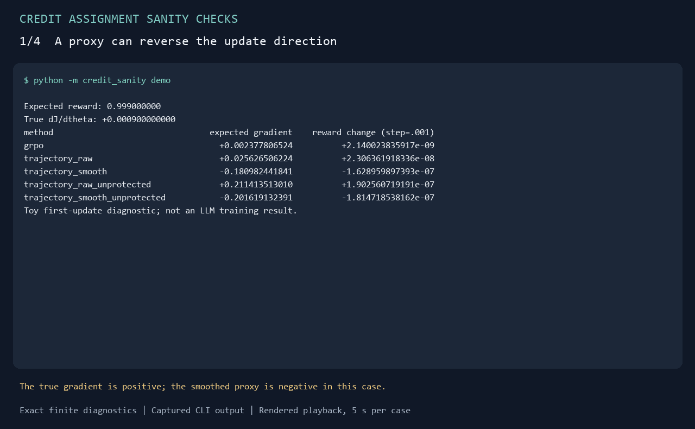

# Credit Assignment Sanity Checks

[](https://github.com/Cookie-27/credit-assignment-sanity-checks/actions/workflows/checks.yml)

[中文说明](README.zh-CN.md)

**Check the update direction of an RL credit signal in an exact CPU experiment.**

For RL researchers and students who want to inspect how scores, normalization,
and smoothing affect a policy update. This small two-step environment has a
known reward gradient, so you can compare a proxy against an exact answer.
Python 3.10+ and the standard library are enough; no GPU or model is required.

[Walkthrough & Python API](docs/walkthrough.md) · [All results](results/summary.md) ·
[Derivation](docs/research_note.md) · [Contributing](CONTRIBUTING.md)

## Try it

Clone the repository (or download and extract its source ZIP), then run:

```bash
git clone https://github.com/Cookie-27/credit-assignment-sanity-checks.git
cd credit-assignment-sanity-checks
python -m credit_sanity demo
```

Expected output includes these lines (the full output lists all five signals):

```text
True dJ/dtheta: +0.000900000000
trajectory_smooth                       -0.180982441841          -1.628959897393e-07
```

The columns on the second line are the proxy gradient and the terminal-reward
change after a logit step of size `.001`. In this example, the proxy moves
against the reward gradient. The checks below show why this does not imply a
general failure of a credit method.

Python calls work in PowerShell, cmd, and POSIX shells. On Windows, use `py -3`
if your installation uses the Python launcher. Run from the repository root;
no `pip install` step is needed. The [source ZIP](https://github.com/Cookie-27/credit-assignment-sanity-checks/releases)
also works after extraction.

## Choose a check

| Question | Command | What to inspect |
|---|---|---|
| Can a proxy point against the reward gradient? | `python -m credit_sanity demo` | True gradient versus each proxy |
| Is policy drift harmful when action values tie? | `python -m credit_sanity demo --q0 1 --q1 1` | Nonzero proxy, zero reward change |
| Does complete action echo change the result? | `python -m credit_sanity demo --echo` | The smoothed proxy becomes positive |
| Does a winner swap change an identical decision's total weight? | `python -m credit_sanity coefficient-demo` | Equal aggregate coefficients |

The [walkthrough](docs/walkthrough.md) explains each check and shows how to
change `q0`, `q1`, `p`, group size, and smoothing through Python or the CLI.
Its Python examples execute in CI.

## Demo



This animation displays actual captured command output; it is a rendered
transcript, not a screen recording. [Accessible text and reproduction commands](docs/demo.md).

## What the first example shows

A policy picks action 0 with probability `p`. Action `a` succeeds with
probability `q[a]`; a second, deterministic submit action ends the episode.
There is one trainable logit. Every hindsight probability is computed by
Bayes' rule, so a learned critic's errors are excluded from this example.

At `q=(1, .99), p=.9, group=8`, the exact expected first-update gradients are:

| Signal | Expected gradient |
|---|---:|
| True terminal-reward gradient | +0.000900000000 |
| Group-standardized terminal reward (`grpo`) | +0.002377806524 |
| Trajectory-normalized scores, successful-negative protection | +0.025626506224 |
| Same proxy with adjacent smoothing | −0.180982441841 |

The smoothed proxy points against the terminal-reward gradient in this
particular example. The sweep includes all 240 fixed conditions, including
controls that do **not** support a general failure claim.

## The complete fixed grid

Eight reward-probability pairs, five initial action probabilities, group sizes
2/4/8, and two outcome representations. Counts below refer to grid conditions,
not estimated frequencies in natural agent tasks.

| Signal | Non-echo opposite directions / 75 non-tied conditions | Non-echo drift / 45 tied conditions |
|---|---:|---:|
| `grpo` | 0 | 0 |
| `trajectory_raw` | 12 | 36 |
| `trajectory_smooth` | 23 | 36 |
| `trajectory_raw_unprotected` | 18 | 36 |
| `trajectory_smooth_unprotected` | 24 | 36 |

In the complete-action-echo control, all five signals have zero counted
reversals and zero tied drift. Equal action values can yield policy drift
without any reward reduction. A winner swap between two identical decisions
can also leave their aggregate gradient coefficient unchanged.

These distinctions are part of the result, not caveats to discard. This
release establishes finite expected-gradient properties; it does not establish
worse long-run learning, natural LLM failure rates, or a new RL algorithm.

## What's included

- `credit_sanity/exact.py`: exact multinomial enumeration, configurable demo,
  and reward-conditioned HCA control identities.
- `tests/test_exact.py`: independent ordered-sequence enumeration, finite
  differences, support checks, and positive/negative controls.
- `results/theory.json`: all 240 conditions and the derived summary.
- [Readable results](results/summary.md): regenerated by `report` and checked in CI.
- [Research note](docs/research_note.md): derivation, assumptions, and limits.
- [Reproducibility](REPRODUCIBILITY.md): commands and numerical tolerances.
- [References](REFERENCES.md): primary sources and what was implemented.

Recompute and verify the entire grid:

```bash
python -m credit_sanity report
python -m credit_sanity verify
python -m unittest discover -s tests -v
python -m doctest docs/walkthrough.md
```

For artifact regeneration, see [REPRODUCIBILITY.md](REPRODUCIBILITY.md).

The package returns `null` for the inverse-ratio HCA control when an action
cannot reach a positive-reward outcome that another action can reach. Its
support assumptions are explicit; the independent marginal-outcome control
remains available. See the research note for the distinction.

## Source and scope

The normalization and smoothing operations are inspired by
[HCAPO](https://arxiv.org/html/2603.08754v1). This is an independent, idealized
implementation with exact posterior probabilities. It does not reproduce the
authors' code, prompts, environments, or training results. The finite checks
are suitable for inspecting mechanisms and teaching, with no paper-novelty
or general LLM-performance claim.

## Contributing

A useful addition contains a small executable case, its assumptions, a
comparison against a simpler baseline, and an outcome that could falsify the
proposed explanation. See [CONTRIBUTING.md](CONTRIBUTING.md) for the experiment
checklist and validation commands.
The [roadmap](ROADMAP.md) lists small contributions and research extensions.

## License

The original code, documentation, and generated finite-experiment results in
this repository are provided under the [MIT license](LICENSE). Referenced
papers retain their own terms; their text, code, weights, and datasets are not
distributed here.
