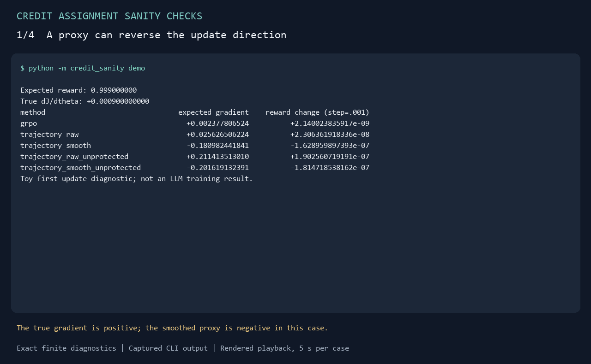

# 信用分配检查工具

[](https://github.com/Cookie-27/credit-assignment-sanity-checks/actions/workflows/checks.yml)

[English](README.md)

**用CPU上的精确小实验，检查RL信用信号的更新方向。**

面向研究信用分配的研究者和学生：这个两步环境的真实奖励梯度已知，可以直接检查
评分、归一化和平滑产生的更新是否符合预期。Python 3.10+、纯标准库即可运行，
无需GPU、模型下载或API。

[逐步教程与Python示例](docs/walkthrough.md) · [全部结果](results/summary.md) ·
[公式推导](docs/research_note.md) · [贡献指南](CONTRIBUTING.md)

## 直接运行

克隆仓库（也可下载并解压源码ZIP），然后运行：

```bash
git clone https://github.com/Cookie-27/credit-assignment-sanity-checks.git
cd credit-assignment-sanity-checks
python -m credit_sanity demo
```

输出中包含以下两行（完整输出包含五种信号）：

```text
True dJ/dtheta: +0.000900000000
trajectory_smooth                       -0.180982441841          -1.628959897393e-07
```

第二行的两列数值是代理梯度，以及logit按`.001`步长更新后的终局奖励变化。
这个例子中，代理方向与真实奖励梯度相反。下面的对照帮助判断这个结论适用于什么条件。

请在仓库根目录运行；不需要`pip install`。Windows若使用Python启动器，可将`python`
替换为`py -3`。也可以从[Releases](https://github.com/Cookie-27/credit-assignment-sanity-checks/releases)
下载源码ZIP并解压。

## 选择要检查的问题

| 问题 | 命令 | 观察什么 |
|---|---|---|
| 代理是否可能朝奖励下降方向更新？ | `python -m credit_sanity demo` | 对比真实梯度和代理梯度 |
| 动作价值相同时，漂移是否有害？ | `python -m credit_sanity demo --q0 1 --q1 1` | 代理非零，奖励变化仍为零 |
| 完整动作回显是否改变结论？ | `python -m credit_sanity demo --echo` | 平滑代理变为正向 |
| 相同决策的排名互换是否改变总权重？ | `python -m credit_sanity coefficient-demo` | 合并系数保持相等 |

[逐步教程](docs/walkthrough.md)包含可修改的Python示例、参数含义和边界条件；其中的代码
也由CI执行。

## 运行演示



动画来自实际运行输出，是渲染后的终端文本演示；[纯文本版本与复现命令](docs/demo.md)同样提供。

## 能看见什么

实验第一步二选一，第二步只能提交。最终奖励为0或1，策略只有一个可训练logit。
默认成功概率为`q=(1,.99)`，动作0概率为`.9`，组大小为8。

| 指标 | 精确值 |
|---|---:|
| 真实终局奖励梯度 | +0.000900000000 |
| 普通组标准化奖励梯度 | +0.002377806524 |
| 轨迹内评分代理＋成功保护 | +0.025626506224 |
| 再加相邻平滑 | −0.180982441841 |

该设置下，平滑代理的首步期望更新方向与真实奖励梯度相反。
完整240条件全部提供，避免只展示一个反例。

同样保留三个限制结论：

1. 两动作真实价值相同，策略漂移也可以完全不损害奖励。
2. 给出完整动作回显后，本固定网格中的反向和同值漂移全部消失。
3. 相同输入、相同动作的信用排名互换，可能不改变合并后的更新系数。

所以，本项目支持有限设置中的精确诊断，不据此宣称某方法普遍较差、真实LLM训练受损，
或已经发明新RL算法。

## 如何检查结果

主程序按四类动作/奖励的计数枚举，用多项分布计算精确期望；测试另用独立的有序序列枚举对照。
还包括目标有限差分、HCA恒等式、两步平滑恒等式和边界输入检查。
`verify`会重新计算全部240条件，逐项比较已提交结果。

```bash
python -m credit_sanity report
python -m credit_sanity verify
python -m unittest discover -s tests -v
python -m doctest docs/walkthrough.md
```

当某动作完全无法获得正奖励时，逆比率HCA对照会明确返回`null`，不静默跳过未定义项。
原始理论的概率支持条件及本例适用范围见[研究笔记](docs/research_note.md)。

## 来源与范围

轨迹内归一化、平滑和保护项参考[HCAPO发表公式](https://arxiv.org/html/2603.08754v1)。
代码独立实现，后验使用精确Bayes值；任务、模型和提示都不同于作者实验，不能称为作者代码
复现。项目提供有限环境中的机制诊断和教学示例，尚不构成新RL算法或真实LLM训练受损的证据。

[路线图](ROADMAP.md)列出适合参与的小贡献和待探索方向；反馈问题可使用仓库的两类Issue表单。

[复现说明](REPRODUCIBILITY.md) · [研究笔记](docs/research_note.md) ·
[贡献指南](CONTRIBUTING.md) · [引用](REFERENCES.md) · [MIT许可证](LICENSE)
